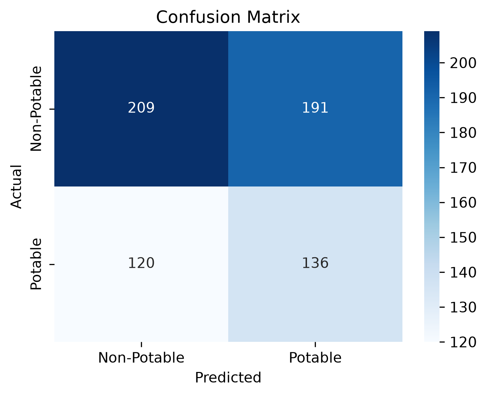

# Binary Classification of Drinking Water Potability

Predicting drinking water safety from 9 continuous physical and chemical metrics using regularized Logistic Regression.

---

## 1. Project Overview

Access to clean drinking water is essential for public health. This project builds an automated classification pipeline to determine whether a water sample is potable (`y = 1`) or non-potable (`y = 0`) using standard physicochemical quality indicators, without requiring slow laboratory biological assays. 

We implement an end-to-end Machine Learning pipeline utilizing median imputation for missing water metrics, standard feature scaling, and balanced Logistic Regression.

---

## 2. Team and Roles

| Member Name | Roll Number | Role | GitHub Handle |
|---|---|---|---|
| **Yatharth Shrivastava** | 2026AIB1099 | **Execution Lead** (Codebase & Architecture) | [@yatharth-2026aib1099](https://github.com/yatharth-2026aib1099) |
| **Ratnadip Bhattacharjee** | 2026EEB1397 | **Documentation Lead** (README & Technical Rigor) | [@Ratnadip-IIT-Ropar](https://github.com/Ratnadip-IIT-Ropar) |
| **Manmohan Singh** | 2026MCB1544 | **PPT Lead** (Slide Deck Architecture) | [@2026mcb1544-manmohansb](https://github.com/2026mcb1544-manmohansb) |
| **Reddi Saran Teja** | 2026EEB1398 | **Video Lead** (Video Presentation & Timekeeping) | [@saranteja2008](https://github.com/saranteja2008) |

---

## 3. Project Structure

```text
water-potability-ai101/
├── data/
│   └── water_potability.csv         # 3,276 water quality records (Kaggle)
├── outputs/
│   └── plots/
│       └── confusion_matrix.png     # Generated evaluation heatmap
├── slides/
│   ├── water_potability_group77.pdf # Strict 5-slide presentation deck (PDF)
│   └── water_potability_group77.pptx# Editable presentation deck (PowerPoint)
├── src/
│   ├── eda.py                       # Exploratory data analysis & summary statistics
│   ├── preprocess.py                # Missing value imputation & StandardScaler
│   ├── train.py                     # Logistic regression model & coefficient extraction
│   └── evaluate.py                  # Performance evaluation (Accuracy, F1, Matrix)
├── requirements.txt                 # Pinned dependency bounds
├── main.py                          # Single execution entrypoint
└── README.md                        # Project documentation
```

---

## 4. Setup and Dependencies

- **Python Version:** Python 3.10+ (tested on Python 3.11, 3.12, and 3.14)
- **Dependencies:** Specified with exact versions in [`requirements.txt`](requirements.txt):
  - `numpy==1.26.4`
  - `pandas==2.2.2`
  - `scikit-learn==1.4.2`
  - `matplotlib==3.8.4`
  - `seaborn==0.13.2`

---

## 5. Steps to Run (Fresh-Clone Reproduction)

To reproduce the complete pipeline from scratch, open your terminal and run:

```bash
# 1. Clone repository
git clone https://github.com/yatharth-2026aib1099/AI101-Group77-WaterPotability.git
cd AI101-Group77-WaterPotability

# 2. Create and activate a clean virtual environment
python3 -m venv venv
source venv/bin/activate   # On Windows: venv\Scripts\activate

# 3. Install pinned dependencies
pip install -r requirements.txt

# 4. Run the end-to-end pipeline
python3 main.py
```

---

## 6. Expected Output and Results

Running `python3 main.py` executes all four modules end-to-end in ~2 seconds, outputting summary statistics, model coefficients, and evaluation metrics:

```text
=== Step 1: Exploratory Data Analysis ===
Dataset Shape: (3276, 10)

Class Distribution:
Potability
0    1998
1    1278
Name: count, dtype: int64

Summary Statistics (Mean, Median, Std Dev):
                         Mean        Median      Std_Dev
ph                   7.080795      7.036752     1.594320
Hardness           196.369496    196.967627    32.879761
Solids           22014.092526  20927.833607  8768.570828
Chloramines          7.122277      7.130299     1.583085
Sulfate            333.775777    333.073546    41.416840
Conductivity       426.205111    421.884968    80.824064
Organic_carbon      14.284970     14.218338     3.308162
Trihalomethanes     66.396293     66.622485    16.175008
Turbidity            3.966786      3.955028     0.780382
Potability           0.390110      0.000000     0.487849

=== Step 2: Preprocessing & Scaling ===

=== Step 3: Model Training ===

Model Coefficients and Odds Ratios:
           Feature  Coefficient  Odds_Ratio
0               ph     0.025615    1.025946
1         Hardness    -0.002128    0.997874
2           Solids     0.059260    1.061051
3      Chloramines     0.041255    1.042118
4          Sulfate    -0.013303    0.986785
5     Conductivity     0.006085    1.006104
6   Organic_carbon    -0.028626    0.971780
7  Trihalomethanes     0.008147    1.008180
8        Turbidity     0.002417    1.002420

=== Step 4: Model Evaluation ===

Evaluation Metrics:
Accuracy:  0.5259
Precision: 0.4159
Recall:    0.5312
F1-score:  0.4666

Confusion Matrix:
 [[209 191]
 [120 136]]
Plot saved to outputs/plots/confusion_matrix.png
```

### Generated Confusion Matrix Plot
The confusion matrix heatmap is automatically generated and saved to `outputs/plots/confusion_matrix.png`:

<p align="center">
  
</p>

---

## 7. Deliverables & Links

- **Presentation Slides (Strict 5-Slide PDF):** [slides/water_potability_group77.pdf](slides/water_potability_group77.pdf)
- **Presentation Slides (PowerPoint):** [slides/water_potability_group77.pptx](slides/water_potability_group77.pptx)
- **Video Presentation (≤ 5:00 min, Unlisted YouTube):** [YouTube Video Link](https://youtu.be/PLACEHOLDER) *(To be updated upon final assembly)*
- **Source Code Repository:** [https://github.com/yatharth-2026aib1099/AI101-Group77-WaterPotability](https://github.com/yatharth-2026aib1099/AI101-Group77-WaterPotability)

---

## 8. AI-Use Disclosure

In accordance with course academic integrity guidelines:
- **ChatGPT & Claude:** Used for background literature research and slide deck structural formatting.
- **Antigravity AI (DeepMind):** Used for codebase architectural modularization and README scaffolding.
- **Verification:** All preprocessing logic (median imputation, feature standardization), model training code, and evaluation metrics were adapted from AI101 lab practices, tested, and validated locally by Group 77 leads. No AI was used to fabricate data or results.
